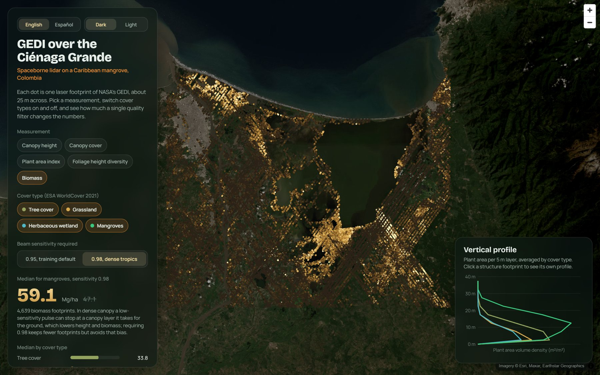
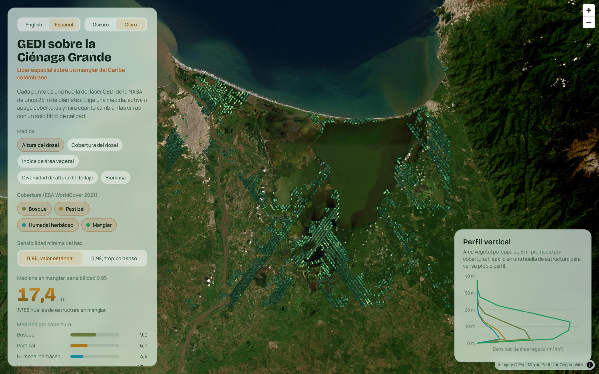

# GEDI Mangrove Explorer

Canopy height, cover, plant area and biomass from NASA's GEDI spaceborne lidar over the Ciénaga Grande de Santa Marta, a Ramsar mangrove wetland on the Caribbean coast of Colombia, in an interactive map you can switch between English and Spanish and between a dark and a light interface.

**Live dashboard: https://linaq11.github.io/gedi-mangrove-explorer/**



## What it shows

Each dot is one GEDI footprint, about 25 m across. The dashboard compares four cover types from ESA WorldCover 2021 (mangroves, herbaceous wetland, grassland and tree cover) on five measurements: canopy height (RH100), canopy cover, plant area index, foliage height diversity and aboveground biomass. Clicking a footprint draws its vertical plant-area profile in 5 m layers.

| Median by cover type | Mangroves | Herbaceous wetland | Grassland | Tree cover |
|---|---|---|---|---|
| Canopy height (m) | 17.4 | 4.4 | 6.1 | 9.0 |
| Canopy cover | 0.77 | 0.04 | 0.07 | 0.22 |
| Plant area index (m²/m²) | 2.94 | 0.07 | 0.14 | 0.50 |
| Biomass, sensitivity ≥ 0.95 (Mg/ha) | 47.1 | 1.0 | 1.4 | 14.4 |
| Biomass, sensitivity ≥ 0.98 (Mg/ha) | 59.1 | 0.4 | 3.2 | 33.8 |

## One filter, a different answer

GEDI's beam sensitivity is the canopy cover a shot can see through and still find the ground. In dense canopy a low-sensitivity shot can stop at a canopy layer and take it for the ground, which lowers the height and the biomass predicted from it. Raising the requirement from 0.95, the usual default, to 0.98, recommended for dense tropics, raises the median mangrove biomass from 47.1 to 59.1 Mg/ha and leaves 4,639 of the 13,580 mangrove biomass footprints. The dashboard lets you flip between the two.



## Data and processing

| Step | Footprints |
|---|---|
| L2B shots in the box, May 2024 to June 2025 | 161,558 |
| after quality filters (quality flag, no degradation, sensitivity ≥ 0.95, valid values, lowest mode within 50 m of the DEM) | 10,751 |
| of which sensitivity ≥ 0.98 | 1,815 |
| on the four compared cover types | 10,307 |
| L4A biomass footprints on the four cover types, April 2019 to February 2025 (quality flag, no degradation, sensitivity ≥ 0.95) | 57,889 |
| of which sensitivity ≥ 0.98 | 13,417 |

* **L2B structure** is read from the GEDI02_B version 2 HDF5 granules, at each shot's own coordinates, with the vertical plant area volume density profile.
* **L4A biomass** is read from Google Earth Engine (`LARSE/GEDI/GEDI04_A_002_MONTHLY`). In that collection the `lat_lowestmode` and `lon_lowestmode` bands are empty, so each biomass footprint sits at the centre of its 25 m cell.
* **Cover type** is ESA WorldCover 2021 at each footprint, sampled in Earth Engine.
* All summaries are medians, because biomass has a long tail of extreme values.

## Reproduce

```bash
pip install -e ".[build]"
python scripts/download_l2b.py --out data/l2b --dry-run      # lists the granules and their size (about 10.8 GB)
python scripts/download_l2b.py --out data/l2b
python scripts/build_dataset.py --granules data/l2b --project <your-earth-engine-project>
python -m http.server --directory docs                       # open http://localhost:8000
```

`pytest` checks the quality filter and that the published data files match their summary.

## Limits

* WorldCover is a global map, not a field survey; its mangrove class includes stands of very different condition.
* Structure (2024–2025) and biomass (2019–2025) cover different years, and biomass footprints are located at cell centres.
* GEDI L4A uses generic allometric models, not models calibrated for these mangroves.

## Credits

GEDI L2B and L4A version 2: NASA, Dubayah et al. (2020), *Science of Remote Sensing* 1, 100002. ESA WorldCover 2021 (CC BY 4.0). Basemap: Esri World Imagery. Map rendering: MapLibre GL JS.

Lina María Quintero Fonseca, geographer, MSc student in Geomatics at the Universidad Nacional de Colombia. Code under the MIT License; to cite, use `CITATION.cff`.
